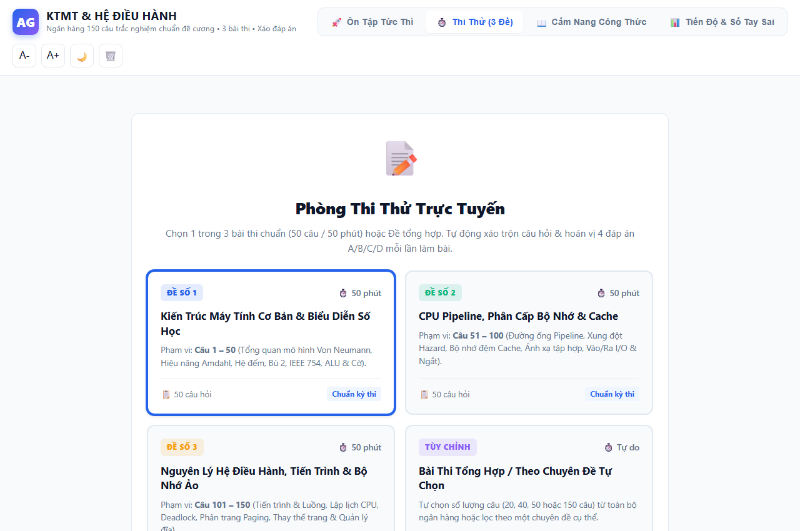
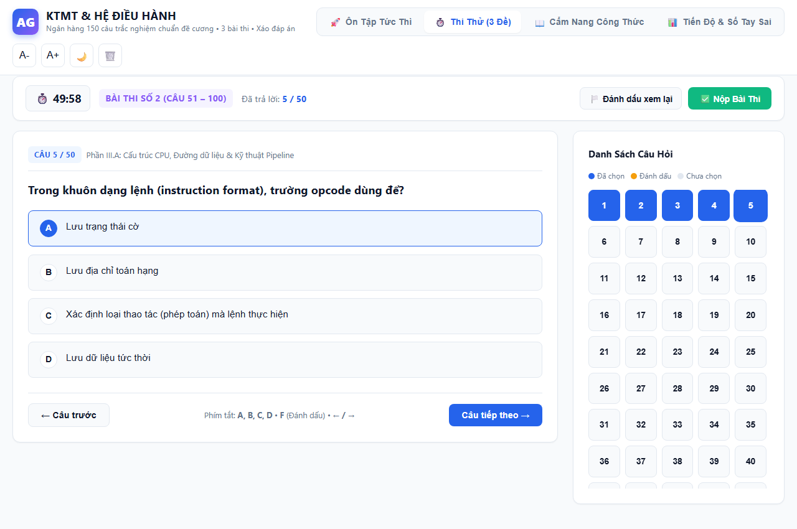
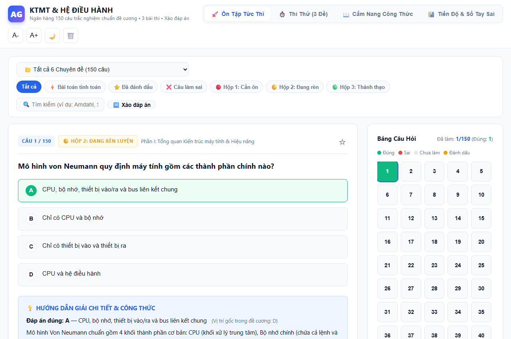
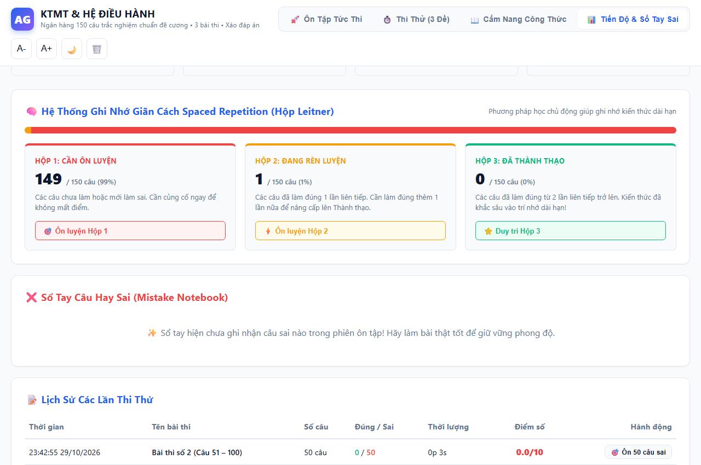
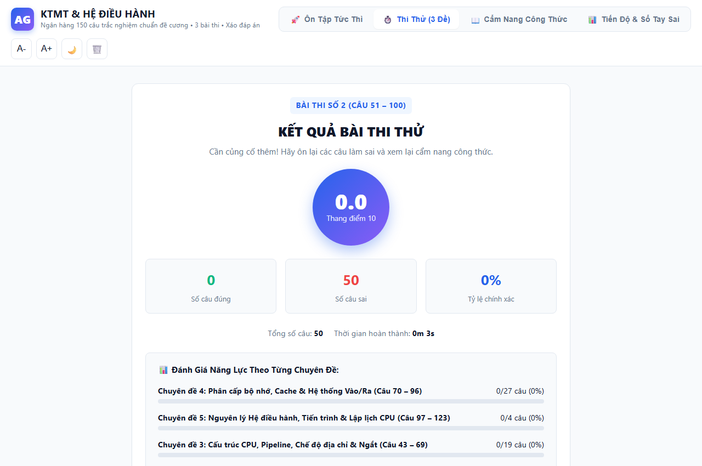
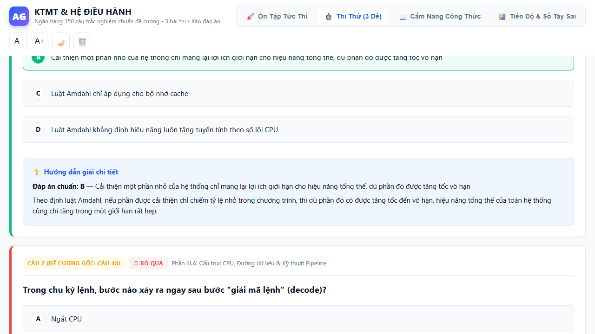
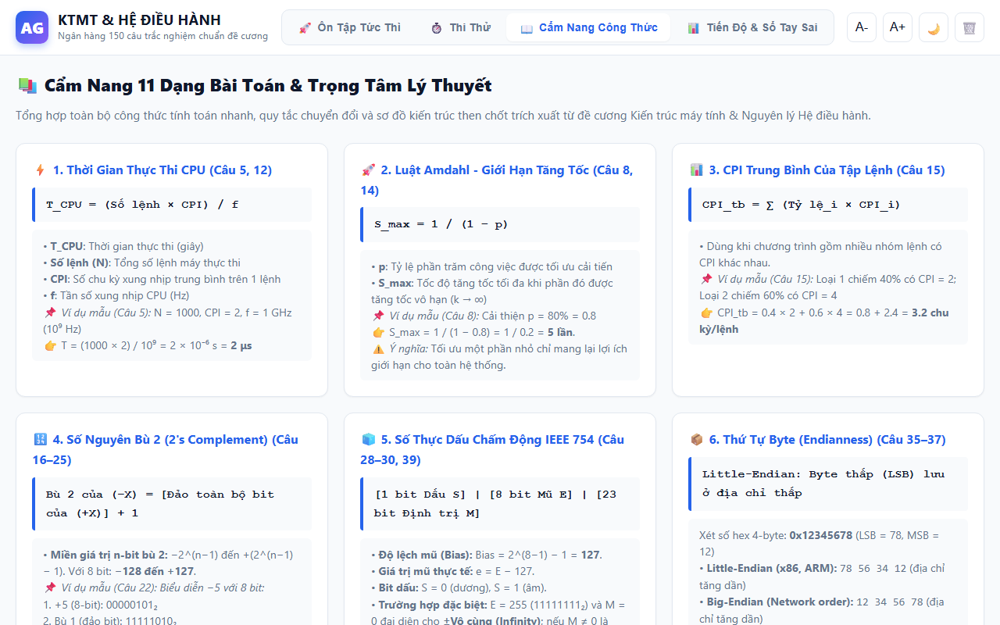

# Hệ Thống Ôn Luyện & Thi Thử Trắc Nghiệm: Kiến Trúc Máy Tính & Nguyên Lý Hệ Điều Hành

Ứng dụng web trực quan, hiện đại, chạy trực tiếp trên trình duyệt (Offline 100%, không cần cài đặt backend hay tạo tài khoản), chuyển đổi toàn bộ **150 câu hỏi trắc nghiệm** từ đề cương chính thức môn **Kiến trúc máy tính & Nguyên lý Hệ điều hành**.

---

## 🌟 Tính Năng Nổi Bật

### 1. Phân Chia 3 Bài Thi Chuẩn (150 câu chia đều 3 bài 50 câu)
- **Đề số 1 (Câu 1 – 50) | 50 phút**: Kiến Trúc Máy Tính Cơ Bản, Hệ Đếm, Biểu Diễn Bù 2, Dấu Phẩy Động IEEE 754 & ALU.
- **Đề số 2 (Câu 51 – 100) | 50 phút**: CPU Pipeline, Phân Cấp Bộ Nhớ, Bộ Nhớ Đệm Cache (Direct, Associative), I/O & Ngắt.
- **Đề số 3 (Câu 101 – 150) | 50 phút**: Nguyên Lý Hệ Điều Hành, Tiến Trình, Lập Lịch CPU, Quản Lý Bộ Nhớ Ảo, Phân Trang & Đĩa.
- **Đề Tổng Hợp / Tùy Chỉnh**: Tự do chọn số lượng câu (20, 40, 50, 150 câu) hoặc theo từng chuyên đề riêng biệt.

---

### 2. Cơ Chế Xáo Trộn Toàn Diện (Luôn Bật - Chống Học Vẹt)
- **Thuật toán Fisher-Yates (Knuth) chuẩn**: Đảm bảo hoán vị phân phối đều 100%, không thiên lệch.
- **Xáo trộn thứ tự câu hỏi**: Mỗi lần thi thử hoặc ôn tập đều có thứ tự câu hoàn toàn mới.
- **Xáo trộn 4 đáp án A/B/C/D**: Vị trí các đáp án A, B, C, D được hoán vị ngẫu nhiên cho từng câu hỏi.
- **Tính nhất quán tuyệt đối**: Khi nộp bài và xem lại (Review), hệ thống lưu chính xác hoán vị đáp án của bài thi đó để sinh viên đối chiếu dễ dàng.
- **Nút "🔀 Xáo đáp án"**: Cho phép xáo lại đáp án tức thì trong lúc ôn tập.

---

### 3. Hệ Thống Ghi Nhớ Giãn Cách Spaced Repetition (Hộp Leitner 3 Cấp Độ)
- **Hộp 1 (🔴 Cần ôn luyện)**: Các câu chưa làm hoặc mới làm sai.
- **Hộp 2 (🟡 Đang rèn luyện)**: Các câu đã làm đúng 1 lần liên tiếp.
- **Hộp 3 (🟢 Đã thành thạo)**: Các câu đã làm đúng liên tiếp từ 2 lần trở lên (kiến thức đã khắc sâu vào trí nhớ dài hạn).
- Tích hợp bộ lọc theo từng hộp ngay trên giao diện ôn tập và bảng điều khiển trực quan trên trang Thống Kê.

---

### 4. Luyện Tập Chuyên Sâu Câu Làm Sai (Targeted Mistake Drill)
- Nút **"🎯 Luyện Tập Ngay Câu Làm Sai"** xuất hiện ngay trên màn hình kết quả thi thử.
- Nhảy thẳng sang chế độ Ôn tập với danh sách riêng các câu vừa làm sai trong đề thi để củng cố lỗ hổng kiến thức ngay lập tức.
- Nút **"🔁 Thi Lại Đề Này (Xáo Mới)"**: Bắt đầu lại ngay đề thi với bộ xáo câu & đáp án mới.

---

### 5. Cẩm Nang Công Thức & Giao Diện Sáng / Tối
- Tổng hợp toàn bộ công thức và dạng bài tính toán trọng tâm: Amdahl, CPU time, AMAT, IEEE 754, Bù 2, Endianness, Paging, SJF...
- Hỗ trợ chế độ nền tối (Dark Theme) bảo vệ mắt và tăng giảm kích cỡ chữ tùy chỉnh.

---

### 6. Sao Lưu & Phục Hồi Dữ Liệu (Backup JSON)
- **Xuất dữ liệu (JSON)**: Tải về file sao lưu toàn bộ tiến độ, danh sách đánh dấu, kết quả thi và trạng thái Spaced Repetition.
- **Nhập dữ liệu (JSON)**: Khôi phục dữ liệu học tập khi chuyển sang thiết bị khác mà không sợ mất lịch sử.

---

## 🚀 Hướng Dẫn Sử Dụng Nhanh

1. Mở file `index.html` trực tiếp bằng bất kỳ trình duyệt nào (Chrome, Edge, Firefox, Cốc Cốc, Safari) hoặc deploy lên GitHub Pages.
2. **Ôn Tập Tức Thì**: Chọn chuyên đề, lọc theo Hộp Leitner (1, 2, 3), câu tính toán hoặc câu làm sai.
3. **Thi Thử**: Bấm chọn 1 trong 3 Đề thi (50 câu - 50 phút) rồi bấm "🚀 Bắt Đầu Làm Bài Thi Ngay".
4. **Xem Lại & Luyện Câu Sai**: Sau khi nộp bài, bấm "🎯 Luyện Tập Ngay Câu Làm Sai" để khắc phục điểm yếu.
5. **Cẩm Nang & Thống Kê**: Tra cứu nhanh công thức và theo dõi tỷ lệ thành thạo 3 Hộp Leitner.
